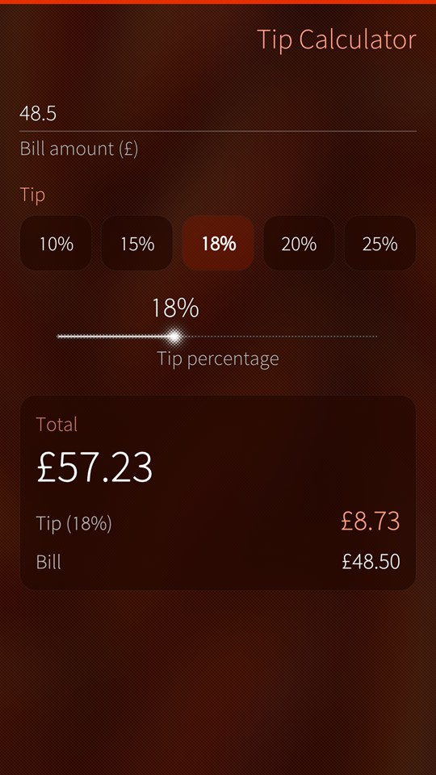
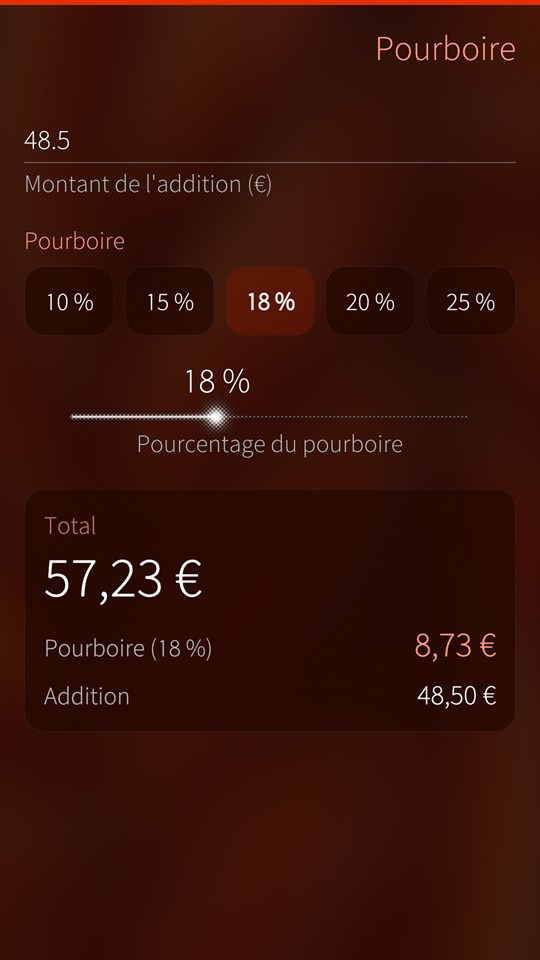
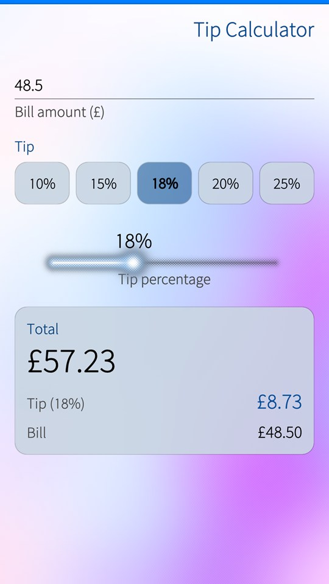

<p align="center">
  
</p>

<h1 align="center">Simple Tip Calculator for Sailfish OS</h1>

<p align="center">
  <b>The tip and the total of a bill, in a few taps.</b><br>
  Type the amount, pick a percentage, read the result, also on the cover.
</p>

<table>
  <tr>
    <td><a href="docs/images/tip.jpg"></a></td>
    <td><a href="docs/images/tip-french.jpg"></a></td>
    <td><a href="docs/images/tip-light.jpg"></a></td>
  </tr>
</table>

## What you get

- **Live results.** The tip and the total follow the bill and the percentage as you change them.
- **Quick percentages.** 10, 15, 18, 20 or 25 % in one tap, anything from 0 to 50 % with the slider.
- **Totals that add up.** The tip is rounded to the cent first, so the bill and the tip always make the total shown.
- **Your currency.** Amounts in the currency and number format of your phone's region; a comma or a point for the cents.
- **Cover support.** The total and the tip without opening the app.

It follows your ambience, light or dark.

## For developers

Build and validate with the Sailfish SDK (`sfdk tools list` shows your targets), or with the Sailfish IDE:

```
sfdk -c target=SailfishOS-5.1.0.11-aarch64 build
sfdk -c target=SailfishOS-5.1.0.11-aarch64 check
```

The package version comes from the latest git tag, so tag the release commit (for example `1.0`) before building it; the About page shows the same version. The build also refreshes the translation catalogues in `translations/`, where new languages are welcome.

## Author

Adel Noureddine (© 2019-2026).

## License

Simple Tip Calculator is licensed under the GNU GPL 3 license only (GPL-3.0-only).

Copyright (c) 2019-2026, Adel Noureddine.
All rights reserved. This program and the accompanying materials are made available under the terms of the GNU General Public License v3.0 only (GPL-3.0-only) which accompanies this distribution, and is available at: https://www.gnu.org/licenses/gpl-3.0.en.html
